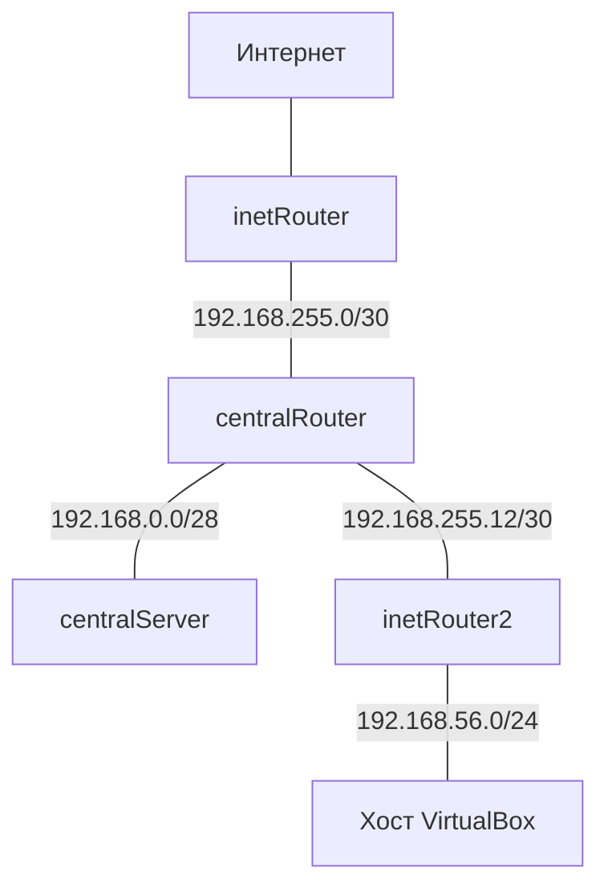

понимать путь прохождения пакетов;
настраивать базовые правила фильтрации;
настраивать наборы правил через ipset;

```bash

## Схема



| ВМ | Лабораторные адреса | Шлюз по умолчанию |
|---|---|---|
| inetRouter | `192.168.255.1/30` | Служебный NAT VirtualBox |
| centralRouter | `192.168.255.2/30`, `192.168.0.1/28`, `192.168.255.13/30` | `192.168.255.1` |
| inetRouter2 | `192.168.255.14/30`, `192.168.56.10/24` | `192.168.255.13` |
| centralServer | `192.168.0.2/28` | `192.168.0.1` |

На внутреннем адресе `inetRouter` TCP/22 открыт только для IP, который постучал в TCP-порты `7001 → 7002 → 7003`

## Запуск

```bash
vagrant validate &&
  ansible-playbook --syntax-check -i localhost, ansible/provision.yml &&
  vagrant up inetRouter centralRouter --provider=virtualbox &&
  vagrant up inetRouter2 centralServer --provider=virtualbox &&
  vagrant status
  ==> inetRouter: You assigned a static IP ending in ".1" or ":1" to this machine.
==> inetRouter: This is very often used by the router and can cause the
==> inetRouter: network to not work properly. If the network doesn't work
==> inetRouter: properly, try changing this IP.
==> centralRouter: You assigned a static IP ending in ".1" or ":1" to this machine.
==> centralRouter: This is very often used by the router and can cause the
==> centralRouter: network to not work properly. If the network doesn't work
==> centralRouter: properly, try changing this IP.
Vagrantfile validated successfully.

playbook: ansible/provision.yml
root@nfsc:~/iptables-lab# vagrant validate &&
  ansible-playbook --syntax-check -i localhost, ansible/provision.yml &&
  vagrant up inetRouter centralRouter --provider=virtualbox &&
  vagrant up inetRouter2 centralServer --provider=virtualbox &&
  vagrant status
==> inetRouter: You assigned a static IP ending in ".1" or ":1" to this machine.
==> inetRouter: This is very often used by the router and can cause the
==> inetRouter: network to not work properly. If the network doesn't work
==> inetRouter: properly, try changing this IP.
==> centralRouter: You assigned a static IP ending in ".1" or ":1" to this machine.
==> centralRouter: This is very often used by the router and can cause the
==> centralRouter: network to not work properly. If the network doesn't work
==> centralRouter: properly, try changing this IP.
Vagrantfile validated successfully.

playbook: ansible/provision.yml
Bringing machine 'inetRouter' up with 'virtualbox' provider...
Bringing machine 'centralRouter' up with 'virtualbox' provider...
==> inetRouter: You assigned a static IP ending in ".1" or ":1" to this machine.
==> inetRouter: This is very often used by the router and can cause the
==> inetRouter: network to not work properly. If the network doesn't work
==> inetRouter: properly, try changing this IP.
==> inetRouter: Importing base box 'generic/ubuntu2004'...
==> inetRouter: Matching MAC address for NAT networking...
==> inetRouter: You assigned a static IP ending in ".1" or ":1" to this machine.
==> inetRouter: This is very often used by the router and can cause the
==> inetRouter: network to not work properly. If the network doesn't work
==> inetRouter: properly, try changing this IP.
==> inetRouter: Setting the name of the VM: iptables-lab-inetRouter
==> inetRouter: Clearing any previously set network interfaces...
==> inetRouter: Preparing network interfaces based on configuration...
    inetRouter: Adapter 1: nat
    inetRouter: Adapter 2: intnet
==> inetRouter: Forwarding ports...
    inetRouter: 22 (guest) => 2222 (host) (adapter 1)
==> inetRouter: Running 'pre-boot' VM customizations...
==> inetRouter: Booting VM...
==> inetRouter: Waiting for machine to boot. This may take a few minutes...
    inetRouter: SSH address: 127.0.0.1:2222
    inetRouter: SSH username: vagrant
    inetRouter: SSH auth method: private key
    inetRouter: Warning: Connection reset. Retrying...
    inetRouter: Warning: Connection reset. Retrying...
    inetRouter: Warning: Remote connection disconnect. Retrying...
    inetRouter: Warning: Connection reset. Retrying...
    inetRouter: Warning: Connection reset. Retrying...
    inetRouter: Warning: Connection reset. Retrying...
    inetRouter: Warning: Connection reset. Retrying...
    inetRouter: Warning: Connection reset. Retrying...
    inetRouter: Warning: Remote connection disconnect. Retrying...
    inetRouter: Warning: Connection reset. Retrying...
    inetRouter: Warning: Connection reset. Retrying...
    inetRouter:
    inetRouter: Vagrant insecure key detected. Vagrant will automatically replace
    inetRouter: this with a newly generated keypair for better security.
    inetRouter:
    inetRouter: Inserting generated public key within guest...
    inetRouter: Removing insecure key from the guest if it's present...
    inetRouter: Key inserted! Disconnecting and reconnecting using new SSH key...
==> inetRouter: Machine booted and ready!
==> inetRouter: Checking for guest additions in VM...
    inetRouter: The guest additions on this VM do not match the installed version of
    inetRouter: VirtualBox! In most cases this is fine, but in rare cases it can
    inetRouter: prevent things such as shared folders from working properly. If you see
    inetRouter: shared folder errors, please make sure the guest additions within the
    inetRouter: virtual machine match the version of VirtualBox you have installed on
    inetRouter: your host and reload your VM.
    inetRouter:
    inetRouter: Guest Additions Version: 6.1.38
    inetRouter: VirtualBox Version: 7.0
==> inetRouter: Setting hostname...
==> inetRouter: Running provisioner: ansible...
    inetRouter: Running ansible-playbook...

PLAY [Настроить сетевую лабораторию] *******************************************

TASK [Gathering Facts] *********************************************************
ok: [inetRouter]

TASK [Создать каталог конфигурации резолвера] **********************************
skipping: [inetRouter]

TASK [Сохранить настройку DNSSEC для лаборатории] ******************************
skipping: [inetRouter]

TASK [Применить настройки резолвера] *******************************************
skipping: [inetRouter]

TASK [Проверить сетевой сервис Ubuntu] *****************************************
ok: [inetRouter]

TASK [Сохранить настройку ядра] ************************************************
changed: [inetRouter]

TASK [Применить настройку ядра] ************************************************
ok: [inetRouter]

TASK [Настроить адреса и маршруты на внутренних интерфейсах] *******************
changed: [inetRouter] => (item=inet-central)

TASK [Оставить DHCP на NAT, отключив маршруты и DNS от него] *******************
skipping: [inetRouter]

TASK [Создать каталог настроек DNS] ********************************************
changed: [inetRouter]

TASK [Настроить DNS VirtualBox на inetRouter] **********************************
changed: [inetRouter]

TASK [Применить настройки DNS] *************************************************
changed: [inetRouter]

TASK [Перечитать конфигурацию интерфейсов] *************************************
ok: [inetRouter]

TASK [Дождаться маршрута через лабораторию] ************************************
skipping: [inetRouter]

TASK [Установить iptables] *****************************************************
ok: [inetRouter]

TASK [Сохранить и проверить правила IPv4] **************************************
changed: [inetRouter]

TASK [Установить службу восстановления правил] *********************************
changed: [inetRouter]

TASK [Применить правила и включить их загрузку при старте] *********************
fatal: [inetRouter]: FAILED! => {"changed": false, "msg": "Unable to start service iptables-lab.service: Job for iptables-lab.service failed because the control process exited with error code.\nSee \"systemctl status iptables-lab.service\" and \"journalctl -xe\" for details.\n"}

PLAY RECAP *********************************************************************
inetRouter                 : ok=12   changed=7    unreachable=0    failed=1    skipped=5    rescued=0    ignored=0

Ansible failed to complete successfully. Any error output should be
visible above. Please fix these errors and try again.

root@nfsc:~/iptables-lab# cd ~/iptables-lab &&
  sed -i -E '/^-A LAB_.*-j REJECT --reject-with tcp-reset$/ { / -p tcp /! s/^(-A LAB_[A-Z]+) /\1 -p tcp /; }' \
    ansible/templates/inetRouter.rules.j2 &&
  vagrant provision inetRouter &&
  vagrant ssh inetRouter -c 'systemctl is-active iptables-lab.service'
==> inetRouter: You assigned a static IP ending in ".1" or ":1" to this machine.
==> inetRouter: This is very often used by the router and can cause the
==> inetRouter: network to not work properly. If the network doesn't work
==> inetRouter: properly, try changing this IP.
==> inetRouter: Running provisioner: ansible...
    inetRouter: Running ansible-playbook...

PLAY [Настроить сетевую лабораторию] *******************************************

TASK [Gathering Facts] *********************************************************
ok: [inetRouter]

TASK [Создать каталог конфигурации резолвера] **********************************
skipping: [inetRouter]

TASK [Сохранить настройку DNSSEC для лаборатории] ******************************
skipping: [inetRouter]

TASK [Применить настройки резолвера] *******************************************
skipping: [inetRouter]

TASK [Проверить сетевой сервис Ubuntu] *****************************************
ok: [inetRouter]

TASK [Сохранить настройку ядра] ************************************************
ok: [inetRouter]

TASK [Применить настройку ядра] ************************************************
ok: [inetRouter]

TASK [Настроить адреса и маршруты на внутренних интерфейсах] *******************
ok: [inetRouter] => (item=inet-central)

TASK [Оставить DHCP на NAT, отключив маршруты и DNS от него] *******************
skipping: [inetRouter]

TASK [Создать каталог настроек DNS] ********************************************
ok: [inetRouter]

TASK [Настроить DNS VirtualBox на inetRouter] **********************************
ok: [inetRouter]

TASK [Применить настройки DNS] *************************************************
skipping: [inetRouter]

TASK [Перечитать конфигурацию интерфейсов] *************************************
ok: [inetRouter]

TASK [Дождаться маршрута через лабораторию] ************************************
skipping: [inetRouter]

TASK [Установить iptables] *****************************************************
ok: [inetRouter]

TASK [Сохранить и проверить правила IPv4] **************************************
changed: [inetRouter]

TASK [Установить службу восстановления правил] *********************************
ok: [inetRouter]

TASK [Применить правила и включить их загрузку при старте] *********************
changed: [inetRouter]

TASK [Установить knock-скрипт на centralRouter] ********************************
skipping: [inetRouter]

TASK [Установить Nginx] ********************************************************
skipping: [inetRouter]

TASK [Сохранить страницу для проверки проброса] ********************************
skipping: [inetRouter]

TASK [Запустить Nginx и включить автозапуск] ***********************************
skipping: [inetRouter]

PLAY RECAP *********************************************************************
inetRouter                 : ok=12   changed=2    unreachable=0    failed=0    skipped=10   rescued=0    ignored=0

active
root@nfsc:~/iptables-lab# vagrant up centralRouter --provider=virtualbox &&
  vagrant up inetRouter2 centralServer --provider=virtualbox
Bringing machine 'centralRouter' up with 'virtualbox' provider...
==> centralRouter: You assigned a static IP ending in ".1" or ":1" to this machine.
==> centralRouter: This is very often used by the router and can cause the
==> centralRouter: network to not work properly. If the network doesn't work
==> centralRouter: properly, try changing this IP.
==> centralRouter: Importing base box 'generic/ubuntu2004'...
==> centralRouter: Matching MAC address for NAT networking...
==> centralRouter: You assigned a static IP ending in ".1" or ":1" to this machine.
==> centralRouter: This is very often used by the router and can cause the
==> centralRouter: network to not work properly. If the network doesn't work
==> centralRouter: properly, try changing this IP.
==> centralRouter: Setting the name of the VM: iptables-lab-centralRouter
==> centralRouter: Fixed port collision for 22 => 2222. Now on port 2200.
==> centralRouter: Clearing any previously set network interfaces...
==> centralRouter: Preparing network interfaces based on configuration...
    centralRouter: Adapter 1: nat
    centralRouter: Adapter 2: intnet
    centralRouter: Adapter 3: intnet
    centralRouter: Adapter 4: intnet
==> centralRouter: Forwarding ports...
    centralRouter: 22 (guest) => 2200 (host) (adapter 1)
==> centralRouter: Running 'pre-boot' VM customizations...
==> centralRouter: Booting VM...
==> centralRouter: Waiting for machine to boot. This may take a few minutes...
    centralRouter: SSH address: 127.0.0.1:2200
    centralRouter: SSH username: vagrant
    centralRouter: SSH auth method: private key
    centralRouter: Warning: Connection reset. Retrying...
    centralRouter: Warning: Connection reset. Retrying...
    centralRouter: Warning: Connection reset. Retrying...
    centralRouter: Warning: Connection reset. Retrying...
    centralRouter: Warning: Connection reset. Retrying...
    centralRouter: Warning: Remote connection disconnect. Retrying...
    centralRouter: Warning: Connection reset. Retrying...
    centralRouter: Warning: Connection reset. Retrying...
    centralRouter: Warning: Connection reset. Retrying...
    centralRouter: Warning: Connection reset. Retrying...
    centralRouter:
    centralRouter: Vagrant insecure key detected. Vagrant will automatically replace
    centralRouter: this with a newly generated keypair for better security.
    centralRouter:
    centralRouter: Inserting generated public key within guest...
    centralRouter: Removing insecure key from the guest if it's present...
    centralRouter: Key inserted! Disconnecting and reconnecting using new SSH key...
==> centralRouter: Machine booted and ready!
==> centralRouter: Checking for guest additions in VM...
    centralRouter: The guest additions on this VM do not match the installed version of
    centralRouter: VirtualBox! In most cases this is fine, but in rare cases it can
    centralRouter: prevent things such as shared folders from working properly. If you see
    centralRouter: shared folder errors, please make sure the guest additions within the
    centralRouter: virtual machine match the version of VirtualBox you have installed on
    centralRouter: your host and reload your VM.
    centralRouter:
    centralRouter: Guest Additions Version: 6.1.38
    centralRouter: VirtualBox Version: 7.0
==> centralRouter: Setting hostname...
==> centralRouter: Running provisioner: ansible...
    centralRouter: Running ansible-playbook...

PLAY [Настроить сетевую лабораторию] *******************************************

TASK [Gathering Facts] *********************************************************
ok: [centralRouter]

TASK [Создать каталог конфигурации резолвера] **********************************
changed: [centralRouter]

TASK [Сохранить настройку DNSSEC для лаборатории] ******************************
changed: [centralRouter]

TASK [Применить настройки резолвера] *******************************************
changed: [centralRouter]

TASK [Проверить сетевой сервис Ubuntu] *****************************************
ok: [centralRouter]

TASK [Сохранить настройку ядра] ************************************************
changed: [centralRouter]

TASK [Применить настройку ядра] ************************************************
ok: [centralRouter]

TASK [Настроить адреса и маршруты на внутренних интерфейсах] *******************
changed: [centralRouter] => (item=inet-central)
changed: [centralRouter] => (item=directors)
changed: [centralRouter] => (item=central-inet2)

TASK [Оставить DHCP на NAT, отключив маршруты и DNS от него] *******************
changed: [centralRouter]

TASK [Создать каталог настроек DNS] ********************************************
skipping: [centralRouter]

TASK [Настроить DNS VirtualBox на inetRouter] **********************************
skipping: [centralRouter]

TASK [Применить настройки DNS] *************************************************
skipping: [centralRouter]

TASK [Перечитать конфигурацию интерфейсов] *************************************
ok: [centralRouter]

TASK [Дождаться маршрута через лабораторию] ************************************
ok: [centralRouter]

TASK [Установить iptables] *****************************************************
skipping: [centralRouter]

TASK [Сохранить и проверить правила IPv4] **************************************
skipping: [centralRouter]

TASK [Установить службу восстановления правил] *********************************
skipping: [centralRouter]

TASK [Применить правила и включить их загрузку при старте] *********************
skipping: [centralRouter]

TASK [Установить knock-скрипт на centralRouter] ********************************
changed: [centralRouter]

TASK [Установить Nginx] ********************************************************
skipping: [centralRouter]

TASK [Сохранить страницу для проверки проброса] ********************************
skipping: [centralRouter]

TASK [Запустить Nginx и включить автозапуск] ***********************************
skipping: [centralRouter]

PLAY RECAP *********************************************************************
centralRouter              : ok=12   changed=7    unreachable=0    failed=0    skipped=10   rescued=0    ignored=0


Bringing machine 'inetRouter2' up with 'virtualbox' provider...
Bringing machine 'centralServer' up with 'virtualbox' provider...
==> inetRouter2: Importing base box 'generic/ubuntu2004'...
==> inetRouter2: Matching MAC address for NAT networking...
==> inetRouter2: Setting the name of the VM: iptables-lab-inetRouter2
==> inetRouter2: Fixed port collision for 22 => 2222. Now on port 2201.
==> inetRouter2: Clearing any previously set network interfaces...
==> inetRouter2: Preparing network interfaces based on configuration...
    inetRouter2: Adapter 1: nat
    inetRouter2: Adapter 2: intnet
    inetRouter2: Adapter 3: hostonly
==> inetRouter2: Forwarding ports...
    inetRouter2: 22 (guest) => 2201 (host) (adapter 1)
==> inetRouter2: Running 'pre-boot' VM customizations...
==> inetRouter2: Booting VM...
==> inetRouter2: Waiting for machine to boot. This may take a few minutes...
    inetRouter2: SSH address: 127.0.0.1:2201
    inetRouter2: SSH username: vagrant
    inetRouter2: SSH auth method: private key
    inetRouter2: Warning: Connection reset. Retrying...
    inetRouter2: Warning: Connection reset. Retrying...
    inetRouter2: Warning: Remote connection disconnect. Retrying...
    inetRouter2: Warning: Connection reset. Retrying...
    inetRouter2: Warning: Connection reset. Retrying...
    inetRouter2: Warning: Connection reset. Retrying...
    inetRouter2: Warning: Connection reset. Retrying...
    inetRouter2: Warning: Remote connection disconnect. Retrying...
    inetRouter2: Warning: Connection reset. Retrying...
    inetRouter2: Warning: Connection reset. Retrying...
    inetRouter2: Warning: Connection reset. Retrying...
    inetRouter2: Warning: Connection reset. Retrying...
    inetRouter2:
    inetRouter2: Vagrant insecure key detected. Vagrant will automatically replace
    inetRouter2: this with a newly generated keypair for better security.
    inetRouter2:
    inetRouter2: Inserting generated public key within guest...
    inetRouter2: Removing insecure key from the guest if it's present...
    inetRouter2: Key inserted! Disconnecting and reconnecting using new SSH key...
==> inetRouter2: Machine booted and ready!
==> inetRouter2: Checking for guest additions in VM...
    inetRouter2: The guest additions on this VM do not match the installed version of
    inetRouter2: VirtualBox! In most cases this is fine, but in rare cases it can
    inetRouter2: prevent things such as shared folders from working properly. If you see
    inetRouter2: shared folder errors, please make sure the guest additions within the
    inetRouter2: virtual machine match the version of VirtualBox you have installed on
    inetRouter2: your host and reload your VM.
    inetRouter2:
    inetRouter2: Guest Additions Version: 6.1.38
    inetRouter2: VirtualBox Version: 7.0
==> inetRouter2: Setting hostname...
==> inetRouter2: Running provisioner: ansible...
    inetRouter2: Running ansible-playbook...

PLAY [Настроить сетевую лабораторию] *******************************************

TASK [Gathering Facts] *********************************************************
ok: [inetRouter2]

TASK [Создать каталог конфигурации резолвера] **********************************
changed: [inetRouter2]

TASK [Сохранить настройку DNSSEC для лаборатории] ******************************
changed: [inetRouter2]

TASK [Применить настройки резолвера] *******************************************
changed: [inetRouter2]

TASK [Проверить сетевой сервис Ubuntu] *****************************************
ok: [inetRouter2]

TASK [Сохранить настройку ядра] ************************************************
changed: [inetRouter2]

TASK [Применить настройку ядра] ************************************************
ok: [inetRouter2]

TASK [Настроить адреса и маршруты на внутренних интерфейсах] *******************
changed: [inetRouter2] => (item=central-inet2)
changed: [inetRouter2] => (item=host-web)

TASK [Оставить DHCP на NAT, отключив маршруты и DNS от него] *******************
changed: [inetRouter2]

TASK [Создать каталог настроек DNS] ********************************************
skipping: [inetRouter2]

TASK [Настроить DNS VirtualBox на inetRouter] **********************************
skipping: [inetRouter2]

TASK [Применить настройки DNS] *************************************************
skipping: [inetRouter2]

TASK [Перечитать конфигурацию интерфейсов] *************************************
ok: [inetRouter2]

TASK [Дождаться маршрута через лабораторию] ************************************
ok: [inetRouter2]

TASK [Установить iptables] *****************************************************
ok: [inetRouter2]

TASK [Сохранить и проверить правила IPv4] **************************************
changed: [inetRouter2]

TASK [Установить службу восстановления правил] *********************************
changed: [inetRouter2]

TASK [Применить правила и включить их загрузку при старте] *********************
changed: [inetRouter2]

TASK [Установить knock-скрипт на centralRouter] ********************************
skipping: [inetRouter2]

TASK [Установить Nginx] ********************************************************
skipping: [inetRouter2]

TASK [Сохранить страницу для проверки проброса] ********************************
skipping: [inetRouter2]

TASK [Запустить Nginx и включить автозапуск] ***********************************
skipping: [inetRouter2]

PLAY RECAP *********************************************************************
inetRouter2                : ok=15   changed=9    unreachable=0    failed=0    skipped=7    rescued=0    ignored=0

==> centralServer: Importing base box 'generic/ubuntu2004'...
==> centralServer: Matching MAC address for NAT networking...
==> centralServer: Setting the name of the VM: iptables-lab-centralServer
==> centralServer: Fixed port collision for 22 => 2222. Now on port 2202.
==> centralServer: Clearing any previously set network interfaces...
==> centralServer: Preparing network interfaces based on configuration...
    centralServer: Adapter 1: nat
    centralServer: Adapter 2: intnet
==> centralServer: Forwarding ports...
    centralServer: 22 (guest) => 2202 (host) (adapter 1)
==> centralServer: Running 'pre-boot' VM customizations...
==> centralServer: Booting VM...
==> centralServer: Waiting for machine to boot. This may take a few minutes...
    centralServer: SSH address: 127.0.0.1:2202
    centralServer: SSH username: vagrant
    centralServer: SSH auth method: private key
    centralServer: Warning: Connection reset. Retrying...
    centralServer: Warning: Connection reset. Retrying...
    centralServer: Warning: Connection reset. Retrying...
    centralServer: Warning: Connection reset. Retrying...
    centralServer: Warning: Connection reset. Retrying...
    centralServer: Warning: Connection reset. Retrying...
    centralServer: Warning: Connection reset. Retrying...
    centralServer: Warning: Connection reset. Retrying...
    centralServer: Warning: Connection reset. Retrying...
    centralServer: Warning: Remote connection disconnect. Retrying...
    centralServer: Warning: Connection reset. Retrying...
    centralServer: Warning: Connection reset. Retrying...
    centralServer:
    centralServer: Vagrant insecure key detected. Vagrant will automatically replace
    centralServer: this with a newly generated keypair for better security.
    centralServer:
    centralServer: Inserting generated public key within guest...
    centralServer: Removing insecure key from the guest if it's present...
    centralServer: Key inserted! Disconnecting and reconnecting using new SSH key...
==> centralServer: Machine booted and ready!
==> centralServer: Checking for guest additions in VM...
    centralServer: The guest additions on this VM do not match the installed version of
    centralServer: VirtualBox! In most cases this is fine, but in rare cases it can
    centralServer: prevent things such as shared folders from working properly. If you see
    centralServer: shared folder errors, please make sure the guest additions within the
    centralServer: virtual machine match the version of VirtualBox you have installed on
    centralServer: your host and reload your VM.
    centralServer:
    centralServer: Guest Additions Version: 6.1.38
    centralServer: VirtualBox Version: 7.0
==> centralServer: Setting hostname...
==> centralServer: Running provisioner: ansible...
    centralServer: Running ansible-playbook...

PLAY [Настроить сетевую лабораторию] *******************************************

TASK [Gathering Facts] *********************************************************
ok: [centralServer]

TASK [Создать каталог конфигурации резолвера] **********************************
changed: [centralServer]

TASK [Сохранить настройку DNSSEC для лаборатории] ******************************
changed: [centralServer]

TASK [Применить настройки резолвера] *******************************************
changed: [centralServer]

TASK [Проверить сетевой сервис Ubuntu] *****************************************
ok: [centralServer]

TASK [Сохранить настройку ядра] ************************************************
skipping: [centralServer]

TASK [Применить настройку ядра] ************************************************
skipping: [centralServer]

TASK [Настроить адреса и маршруты на внутренних интерфейсах] *******************
changed: [centralServer] => (item=directors)

TASK [Оставить DHCP на NAT, отключив маршруты и DNS от него] *******************
changed: [centralServer]

TASK [Создать каталог настроек DNS] ********************************************
skipping: [centralServer]

TASK [Настроить DNS VirtualBox на inetRouter] **********************************
skipping: [centralServer]

TASK [Применить настройки DNS] *************************************************
skipping: [centralServer]

TASK [Перечитать конфигурацию интерфейсов] *************************************
ok: [centralServer]

TASK [Дождаться маршрута через лабораторию] ************************************
ok: [centralServer]

TASK [Установить iptables] *****************************************************
skipping: [centralServer]

TASK [Сохранить и проверить правила IPv4] **************************************
skipping: [centralServer]

TASK [Установить службу восстановления правил] *********************************
skipping: [centralServer]

TASK [Применить правила и включить их загрузку при старте] *********************
skipping: [centralServer]

TASK [Установить knock-скрипт на centralRouter] ********************************
skipping: [centralServer]

TASK [Установить Nginx] ********************************************************
changed: [centralServer]

TASK [Сохранить страницу для проверки проброса] ********************************
changed: [centralServer]

TASK [Запустить Nginx и включить автозапуск] ***********************************
ok: [centralServer]

PLAY RECAP *********************************************************************
centralServer              : ok=12   changed=7    unreachable=0    failed=0    skipped=10   rescued=0    ignored=0

root@nfsc:~/iptables-lab#


```


## Проверка SSH после knock

Проверить закрытый порт:

```bash
root@nfsc:~/iptables-lab# vagrant status
Current machine states:

inetRouter                running (virtualbox)
centralRouter             running (virtualbox)
inetRouter2               running (virtualbox)
centralServer             running (virtualbox)

This environment represents multiple VMs. The VMs are all listed
above with their current state. For more information about a specific
VM, run `vagrant status NAME`.


root@nfsc:~/iptables-lab# vagrant ssh centralRouter -c 'if timeout 3 bash -c "true < /dev/tcp/192.168.255.1/22" 2>/dev/null; then echo "ОШИБКА: TCP/22 уже открыт"; exit 1; else echo "TCP/22 закрыт до knock"; fi'
TCP/22 закрыт до knock

root@nfsc:~/iptables-lab# vagrant ssh centralRouter -c 'umask 077; mkdir -p ~/.ssh; test -f ~/.ssh/iptables-lab_ed25519.pub || ssh-keygen -q -t ed25519 -N "" -C iptables-lab -f ~/.ssh/iptables-lab_ed25519' &&
  knock_pub=$(vagrant ssh centralRouter -c 'cat ~/.ssh/iptables-lab_ed25519.pub') &&
  knock_pub=${knock_pub//$'\r'/} &&
  [[ "$knock_pub" =~ ^ssh-ed25519[[:space:]][A-Za-z0-9+/=]+[[:space:]]iptables-lab$ ]] &&
  vagrant ssh inetRouter -c "umask 077; mkdir -p ~/.ssh && touch ~/.ssh/authorized_keys && { grep -Fxq '$knock_pub' ~/.ssh/authorized_keys || echo '$knock_pub' >> ~/.ssh/authorized_keys; }"

root@nfsc:~/iptables-lab# vagrant ssh centralRouter -c 'knock-ssh && ssh -i ~/.ssh/iptables-lab_ed25519 -o BatchMode=yes -o ConnectTimeout=5 -o StrictHostKeyChecking=accept-new vagrant@192.168.255.1 hostname'
Последовательность отправлена. Проверь TCP/22 в течение 30 секунд.
Warning: Permanently added '192.168.255.1' (ECDSA) to the list of known hosts.
inetrouter
root@nfsc:~/iptables-lab#

```

## Проверка  Nginx, проброс и выход в интернет

Сначала проверь Nginx внутри `centralServer`, затем сделай запрос с хоста VirtualBox:

```bash
root@nfsc:~/iptables-lab# curl --noproxy '"'"'*'"'"' -fsS --max-time 10 http://192.168.56.10:8080/
<!doctype html>
<meta charset="utf-8">
<title>OTUS iptables lab</title>
<h1>centralServer: nginx OK</h1>

```

```bash
root@nfsc:~/iptables-lab# vagrant ssh inetRouter2 -c 'sudo iptables -t nat -vnL PREROUTING; sudo iptables -t nat -vnL POSTROUTING'
Chain PREROUTING (policy ACCEPT 2 packets, 88 bytes)
 pkts bytes target     prot opt in     out     source               destination
    1    60 DNAT       tcp  --  *      *       192.168.56.0/24      192.168.56.10        tcp dpt:8080 to:192.168.0.2:80
Chain POSTROUTING (policy ACCEPT 2 packets, 116 bytes)
 pkts bytes target     prot opt in     out     source               destination
    1    60 MASQUERADE  tcp  --  *      *       192.168.56.0/24      192.168.0.2          tcp dpt:80 ctstate DNAT

```


```bash
root@nfsc:~/iptables-lab# vagrant ssh centralRouter -c 'ip -4 route show default'
vagrant ssh centralServer -c 'ip -4 route show default; timeout 10 bash -c "true < /dev/tcp/1.1.1.1/443" && echo "TCP наружу работает"'
default via 192.168.255.1 dev eth1 proto static
default via 192.168.0.1 dev eth1 proto static
TCP наружу работает
root@nfsc:~/iptables-lab#

```
